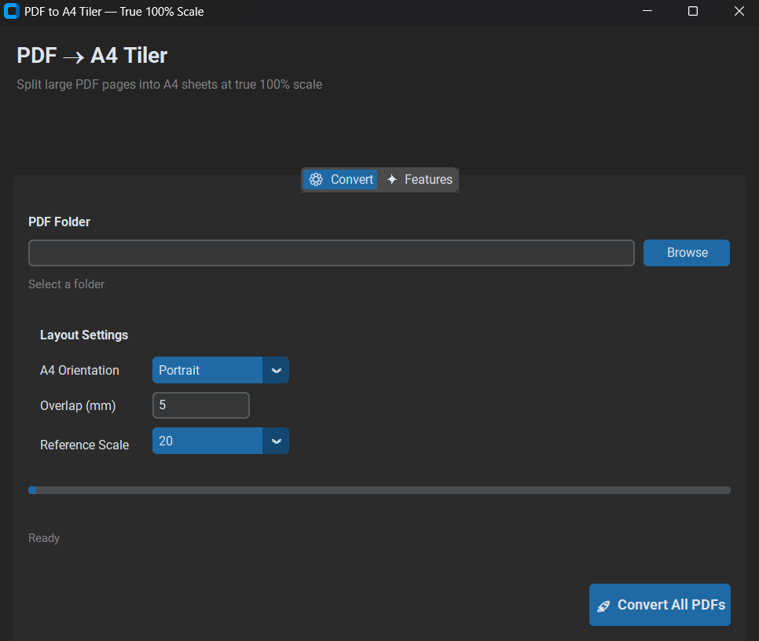

# PDF → A4 Tiler

Split large PDF pages into A4 sheets at **true 100% scale** — no scaling, no rasterization.

> Perfect for tiling large artwork, schematics, blueprints, or posters for physical printing.

## ✨ Features

| Feature | Detail |
|---------|--------|
| 📐 True 100% Scale | Artwork placed at exact source size — print at 100% |
| ✂️ Crop Marks | 4-corner ticks in margin, never crosses the design |
| 🎯 Alignment Crosshairs | Registration marks for precise multi-sheet assembly |
| 📏 Reference Scale Bar | 10 mm or 20 mm bar on every page |
| 📄 Tile Identification | Page no., source page, row & col in footer |
| 📁 Batch Processing | Entire folder → `A4_Tiled/` subfolder in one click |
| 🔄 Overlap Control | 0–24.9 mm adjustable overlap |
| 🖥️ Portrait / Landscape | A4 orientation selectable |
| 🔒 Non-Destructive | Originals never modified |
| ⚡ Vector Preserved | No rasterization — text & vectors stay crisp |

## 📸 Screenshot

<!-- Replace with your actual screenshot -->


## 🚀 Installation

```bash
 2. Install dependencies
pip install -r requirements.txt   
